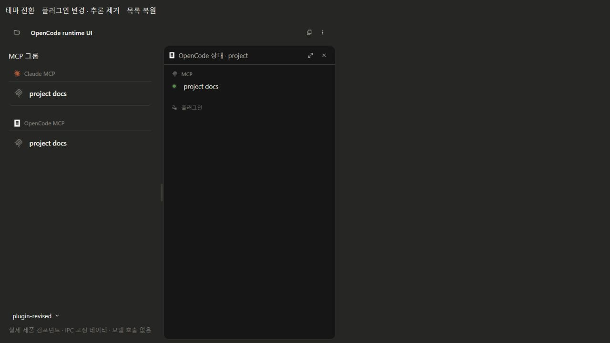

# 0268 구현 관측 — 2026-10-20

부분 구현이다. 토스트 비활성화는 완료하지 못했다. 독립 verify 결과는 아니다.
AC·pair·강제 지점별 자기판정은 [plan의 구현자 기입](../plan.md)이 정본이다.

## 자동 검증

| 대상 | 관측 |
|---|---|
| 관련 통합 집합 | 35파일 / 353시험 PASS |
| 마지막 수명·IPC 보강 | adapter, persistent channel, session-resources 3파일 / 55시험 PASS |
| 마지막 패널 보강 | rightPanelLayout, chatStore.panelTiles 2파일 / 15시험 PASS |
| Composer 컴포넌트 위치 정리 후 | Module.integration, Controls.interaction 2파일 / 4시험 PASS |
| build | node/web/test typecheck 모두 통과, main/preload/renderer 번들 생성 |
| lint | 전체 실행 오류 0. 당시 경고 6: 기존 포맷 2·기존 TanStack 2·신규 Fast Refresh 2. 신규 Fast Refresh 원인을 Controls 파일로 옮긴 뒤 해당 파일 lint 오류/경고 0 |
| 마지막 변경 파일 lint | channel·adapter 테스트·IPC 테스트·패널 테스트 오류/경고 0 |
| harness boundary | 8/8 PASS |
| renderer catalog | source 295 / 문서 295, 양쪽 차집합 빈 배열; 링크 음성 대조 8/8 red |
| inventory | 생성 문서 일치, current-state 수치 재서술 없음 |
| raw link gate | ignored `.tmp/opencode-dev`의 기존 broken links 5건으로 실패 |
| workspace links | 기존 exclusion에 `.tmp/`, `.codex-remote-attachments/`를 더해 분리 검사한 결과 `[]` |

시험 수는 실행 집합끼리 겹치므로 합산하지 않는다. 마지막 수정과 관련된 집합만 다시 실행했다.
실제 API 유료 요청은 하지 않았다. ABI를 바꾸는 `npm test`/재설치는 실행하지 않았다.
초기 통합 집합은 Electron ABI 호환 Node 모드·thread pool에서 수행했다.
마지막 비-DB 시험은 일반 Node로 수행했다. GUI용 Electron 실행 파일로 Node 모드를 호출했지만
시험 출력이 없었던 시도는 검증 성공으로 세지 않고 Node의 실제 리포터 산출로 대체했다.

재현 명령은 `app/`에서 실행한다.

```powershell
npm run build
node node_modules/eslint/bin/eslint.js ./src ./scripts
node --test scripts/harness-boundary.test.mjs
node scripts/check-doc-inventory.mjs --check
node scripts/smoke-opencode-startup.mjs

node node_modules/vitest/vitest.mjs run --pool=threads --maxWorkers=2 `
  src/main/adapters/opencode/v1/adapter.test.ts `
  src/main/adapters/opencode/v1/adapter.persistent.test.ts `
  src/main/app/handlers/session-resources.test.ts `
  src/renderer/src/features/chat/lib/rightPanelLayout.test.ts `
  src/renderer/src/features/chat/store/chatStore.panelTiles.test.ts `
  src/renderer/src/features/chat/harnesses/opencode/composer/Module.integration.test.ts `
  src/renderer/src/features/chat/harnesses/opencode/composer/Controls.interaction.test.ts
```

초기 35파일 집합은 `src/main/adapters/opencode/v1/`의 테스트 전체와 다음 파일이다.

- `src/main/app/chat-turn/opencode-runtime.test.ts`
- `src/main/app/handlers/{context-file,files.contextDirectory,session-resources}.test.ts`
- `src/main/infra/external-navigation.test.ts`
- `src/renderer/src/features/chat/components/ChatTitleBar.render.test.ts`
- `src/renderer/src/features/chat/harnesses/opencode/composer/{Controls.interaction,Module.integration}.test.ts`
- `src/renderer/src/features/chat/harnesses/opencode/rightpanel/Panel.interaction.test.ts`
- `src/renderer/src/features/chat/lib/{nativeResourceState.composer,rightPanelLayout}.test.ts`
- `src/renderer/src/features/chat/store/{artifactViewerStore,chatStore.panelTiles}.test.ts`
- `src/renderer/src/features/skills/components/customize/CustomizeList.render.test.ts`

## 실제 CLI 시작·회수

`smoke-opencode-startup.mjs`가 production OpenCodeServerPool을 로드한다.
임시 HOME/XDG/config, 빈 테스트 세션과 loopback만 사용한다. 세션은 시험 후 삭제하고
자신이 시작한 프로세스만 해제한다. 사용자 설정·기존 Desktop 프로세스는 변경하지 않는다.

| 측정 | 부하가 낮은 실행 | build/test 동시 실행 |
|---|---:|---:|
| cold acquire | 4064ms | 11525ms |
| version subprocess | 1603ms | 4061ms |
| spawn 이후 health 준비 | 2450ms | 7437ms |
| 같은 서버 warm acquire | 5ms | 6ms |
| 첫 빈 세션 생성 | 미측정 | 896ms |
| 다음 빈 세션 생성 | 미측정 | 749ms |
| spawn 수 / 마지막 해제 후 종료 | 1 / 확인 | 1 / 확인 |

이 수치는 **같은 실행 구성·환경·cwd**에서 측정했다. 현재 pool key에는 cwd가 있으므로
프로젝트 경로가 달라지면 별도 서버를 시작한다. 프로젝트 간 단일 서버 공유를 구현하거나
측정한 결과가 아니다. 모든 owner가 LRU로 해제되면 서버도 종료되고 다음 사용은 다시 cold start다.
OpenCode Desktop과 같은 조건으로 비교하지 않았으므로 성능 동등성을 주장하지 않는다.

## 실제 Chromium 표시

Vite 임시 fixture에서 실제 ChatTitleBar/RightPanel/ComposerModule/CustomizeList와 store/cache를 렌더했다.
IPC 응답만 fixture로 공급했다. 설치된 Electron 앱을 재시작하거나 변경하지 않았다.

- 상태 메뉴 클릭: task 열 위에 상세가 열리고 기존 폭을 사용했다.
- Esc: 작업 내용 복원, 대화 메뉴 버튼으로 초점 복귀.
- live `plugin-review / deep`에서 `plugin-revised / 빈 variants`로 변경: 에이전트 목록 갱신, 추론 선택기 제거.
- 첫/후속 MCP 그룹 padding은 root 14.5px에서 18.125px/29px. Skills와 같은 1.25rem/2rem이다.
- light/dark에서 Claude 브랜드 색, OpenCode 테마 대비 색, Orca 로고 확인.



실제 Explorer 창과 OS 기본 브라우저 기동은 실행하지 않았다.
파일은 검증된 경로에 대한 shell sink 호출을, 링크는 등록 helper의 이벤트→shell 호출을 시험했다.
main/index의 helper 호출 배선과 실제 Markdown 클릭은 별도 직접 oracle 없이 남아 있다.

## OpenCode 토스트 — 미완료

사용자는 발신 앱을 OpenCode, 발생 시점을 답변·작업 완료, 적용 범위를 Orca 실행으로 명확히 했다.
설치된 Desktop 설정에서 확인한 `settings.v3.notifications.agent`는 켜져 있었다.
조사한 OpenCode UI의 session-idle 알림은 이 값을 확인한 뒤 `platform.notify`로 이어진다.

이 키는 Desktop UI 설정이며 Orca가 띄우는 headless CLI 1.x Config DTO의 키가 아니다.
CLI Config/serve 옵션에서 Orca 실행에만 적용되는 대응 스위치를 확인하지 못했다.
Desktop 전역 `default.dat` 수정, Windows 앱 전체 알림 차단, 기존 OpenCode 프로세스 종료는 하지 않았다.
임의의 `notifications` 키를 OPENCODE_CONFIG_CONTENT에 넣지도 않았다.

[OpenCode 설정 문서](https://docs.opencode.ai/docs/config/)의 CLI 설정과
[문제 해결 문서](https://docs.opencode.ai/docs/troubleshooting/)의 Desktop OS 알림 설명을 구분했다.
별도 loopback 포트는 서버 격리 조치다. 실제 완료 토스트를 막았다는 증거가 아니므로 AC4를 미확인으로 유지한다.
