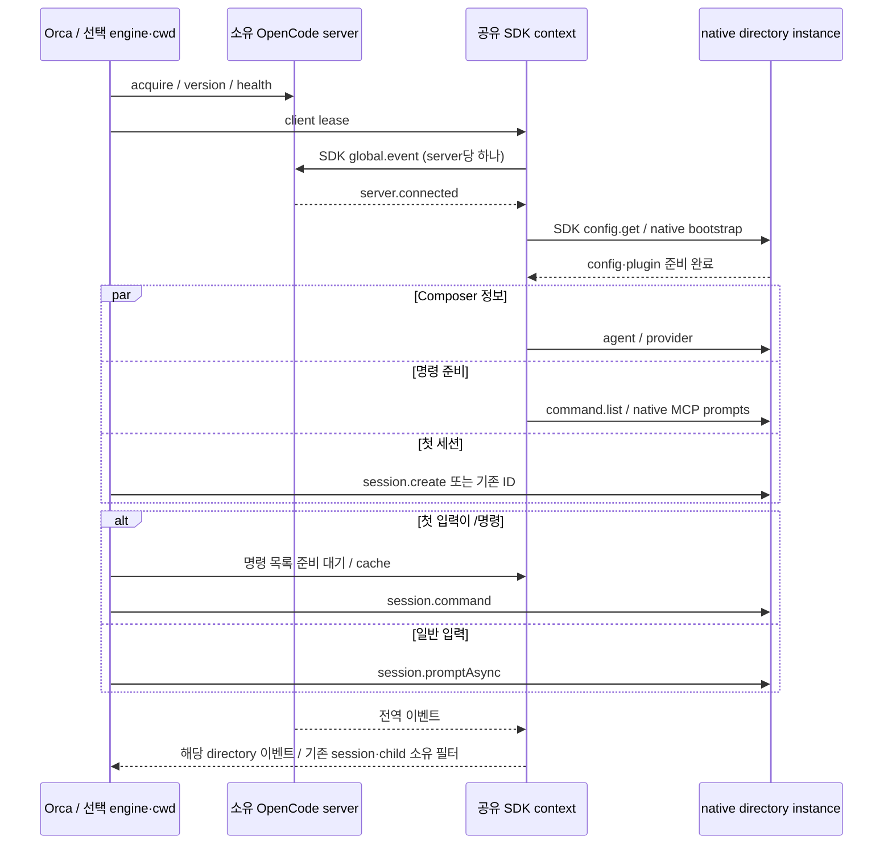

# Desktop 기준 부팅부터 첫 세션까지 — OpenCode 1.17.19

2026-10-21. 사용자 테스트 버전인 **1.17.19**의 소스 `dc927a7ff071741537cb0bdac7e09b5667ed568d`를 기준으로 분석했다. Orca의 SDK는 설치된 `@opencode-ai/sdk 1.18.27`의 `/v2/client`이며, 실제1.17.19 CLI와 Electron 전송으로 별도 검증했다.

## 참조 시퀀스

| 단계 | Desktop 소스에서 확인한 동작 | Orca의 대응 |
|---|---|---|
| host 시작 | main의 환경·TLS/proxy·앱 단일 인스턴스 준비 | 기존 Orca 설정·권한·하네스 registry·Chromium 전송 배선 |
| local server 준비 | 앱 loading task의 sidecar → ready/health. 기본 v1은 utilityProcess의 Server.listen | 선택 engine/cwd가 확정된 SDK 연결에서 소유 CLI serve acquire→버전/health 확인 |
| renderer 진입 | sidecar 등 초기 리소스가 준비되면 AppInterface 진입 | 기존 Orca UI 수명 유지. native runtime은 선택 하네스의 첫 연결에서 준비 |
| 서버 단위 데이터 | `bootstrapGlobal`이 config/provider/path/projects를 독립 작업으로 요청 | 엔진 설정·Orca 프로젝트 목록은 기존 앱 저장소가 담당. native 프로젝트 config는 SDK로 읽어 bootstrap 완료를 확인 |
| 이벤트 수신 | server-sdk의 global.event 단일 run, directory별 emitter. server-sync mount에서 시작 | 같은 소유 server URL+auth generation의 SDK/global SSE 하나, directory 경계로 구독자에게 배분 |
| 프로젝트 준비 | InstanceStore가 directory별 bootstrap을 합침. config→plugin.init 이후 서비스 init | 같은 directory의 config barrier·명령/composer 준비 flight/cache를 공유 |
| 주변 정보 | directory status를 partial로 열고 agent/config/session/VCS/command/permission/question 등을 병렬 요청 | 실제로 소비하는 agent/provider/command를 병렬 준비. 일반 입력은 command 목록을 기다리지 않음 |
| 첫 session | 기존 session이 없으면 client.session.create, 선택 cwd/worktree 기준 | native config 준비 후 session.create 또는 기존 native ID 사용. 기존 native history 검증 유지 |
| 첫 입력 | 준비된 command 목록에 /name이 있으면 session.command, 아니면 promptAsync | 같은 instance의 성공한 command 목록으로 판별. Orca의 스킬 메뉴가 먼저 보일 수 있으므로 첫 slash는 목록 준비를 기다림 |
| 후속·중단 | 연결/프로젝트 데이터를 공유, 개별 작업의 cancel/오류 관리 | warm 채널·개별 lease 유지. 한 close가 다른 세션의 stream/준비를 종료하지 않음 |

고정 태그의 source 좌표: `packages/desktop/src/main/{index,server,sidecar}.ts`, `packages/desktop/src/renderer/index.tsx:383`, `packages/app/src/context/server-sdk.tsx`, `server-sync.tsx:330,430`, `global-sync/bootstrap.ts:107,206,232–291`, `packages/app/src/components/prompt-input/submit.ts:70–84`와 첫 `session.create` 경로, `packages/opencode/src/project/{instance-store,bootstrap}.ts`.
재현 명령은 `git -C app/.temp/opencode show v1.17.19:<경로>`다.

Desktop도 모든 부팅 조회를 직렬 barrier로 묶지 않는다. global 이벤트 연결과 UI 정보 로딩이 겹치며 프로젝트 목록은 partial 상태에서 갱신된다. Orca는 NormalizedEvent 전달 전에 이벤트 수신을 확보해야 하므로 **global server.connected 확인을 첫 준비/제출보다 앞에 둔다**.

## Orca의 현재 시작 순서

근거: [session-context.ts](../../../app/src/main/adapters/opencode/v1/session-context.ts), [adapter.ts](../../../app/src/main/adapters/opencode/v1/adapter.ts), [channel.ts](../../../app/src/main/adapters/opencode/v1/channel.ts). engine/config/env/cwd가 다른 server를 하나로 합치는 변경은 하지 않았다.

## timeout 보고와의 관계

실제1.17.19의 `Command.state`도 `mcp.prompts()`를 읽는다. 이전 2.5초 메뉴용 제한을 실행 전 준비에도 사용하면 정상적인 초기 MCP 준비가 timeout이 될 수 있다. [0273 실측](../0273-opencode-command-stream-errors/plan.md)에서 의도적으로 지연한 MCP로 이를 재현했다.

현재는 프로젝트 준비와 global SSE 준비가 서로 다른 단계다. Composer의 짧은 조회 예산은 config/plugin bootstrap 뒤에 시작하며, command 준비는 공유되고 slash만 기다린다. SDK가 감추던 SSE HTTP 상태·timeout·EOF도 안전한 오류로 전달한다.

사용자 환경에서 재시도 SSE가 실패한 구체 원인은 아직 확정하지 않았다. 첫 단독 세션 조건을 다중 세션 소켓 포화의 증거로 취급하지 않는다.

## 실제 SDK·Electron·CLI 관측

| 실행 | 결과 / 의미 |
|---|---|
| 설치 Electron39.8.10 + 실제 adapter 번들 + 제어 HTTP/1.1 서버 | 첫 세션8개와 한 close 뒤 warm 후속 입력 모두 완료. global/event·config·command·agent·provider 각각1회. session 생성8회, lease 해제8회 |
| 같은 Electron + 실제 CLI1.17.19 + 격리 XDG + 의도적3.5초 지연 MCP | global SSE ready2,580ms → project ready3,540ms → session create3,785ms → commands ready7,427ms. command cache hit는 추가 요청 없음 |
| 실제 CLI 요청 집계 | GET global/event·config·command·agent·provider 각1회, session POST/DELETE 각1회. 모델 prompt 없음 |

이 수치는 제어 환경의 실행 증거이며 사용자 설정에서의 성능 benchmark가 아니다. native CLI probe는 생성한 세션을 삭제하고 소유 child tree를 종료했다. 제어 HTTP 서버 probe의 응답은 테스트 데이터이며 LLM 호출이 아니다.

재현 자료: [Electron 다중 세션 결과](evidence/pooled-electron-result.json), [실행 script](evidence/pooled-electron-probe.cjs), [CLI1.17.19 시작 결과](evidence/cli117-context-result.json), [실행 script](evidence/cli117-electron-probe.cjs).

script는 저장소 `.git/opencode-startup-research/` 같은 전용 임시 폴더에 복사해 사용한다. adapter source를 esbuild의 node/cjs 번들로 같은 폴더의 `adapter-bundle.cjs`에 만들고 Electron으로 실행한다. CLI probe는 형제 `opencode-1.17.19/`에 npm tarball과 [제어 MCP script](../0273-opencode-command-stream-errors/evidence/delayed-mcp.cjs)를 준비하고 `ORCA_PROBE_NODE`에 plain Node 실행 경로를 지정한다.
PowerShell에서는 `Start-Process -WindowStyle Hidden -Wait`와 stdout/stderr 파일 리다이렉트로 실행했다. 사용자 설치본·native 설정/DB·실제 모델 계정은 변경하지 않는다.

## 환경에 맞춘 차이와 남은 경계

| 항목 | 판정 |
|---|---|
| 앱 부팅 시 모든 엔진 프로세스 시작 | Orca는 여러 engine/config/env를 지원하므로 해당 engine/cwd가 확정된 첫 SDK 연결에서 시작 |
| Desktop의 프로젝트/VCS/탭/목록 UI 조회 | Orca가 실제로 소비하는 기능과 자체 저장소에 맞춰 대응. 사용하지 않는 UI용 요청은 복제하지 않음 |
| Desktop의 전역 스트림 자동 재접속 | Orca는 수신 공백의 history/approval 재조립 계약이 없으므로 현재 generation을 안전하게 실패시킴. prompt 자동 재제출은 하지 않음 |
| 마지막 owner 해제 뒤 server 수명 | 기존 소유 서버 정리 유지. cold history 조회→실제 전송의 반복 시작과 idle server 보존 정책은 별도 개선 경계 |
| 다중 프로젝트 비용 | process·native instance·MCP 초기화 비용은 남음. 이번 공유는 동일 소유 server 안의 client/stream/준비에 적용 |

지원하는 OpenCode 동작은 native config·plugin bootstrap과 SDK 명령/일반 prompt 의미를 기준으로 준수한다. Desktop 전체 UI나 향후2.x service 구조와 완전히 같아졌다는 주장은 하지 않는다.
